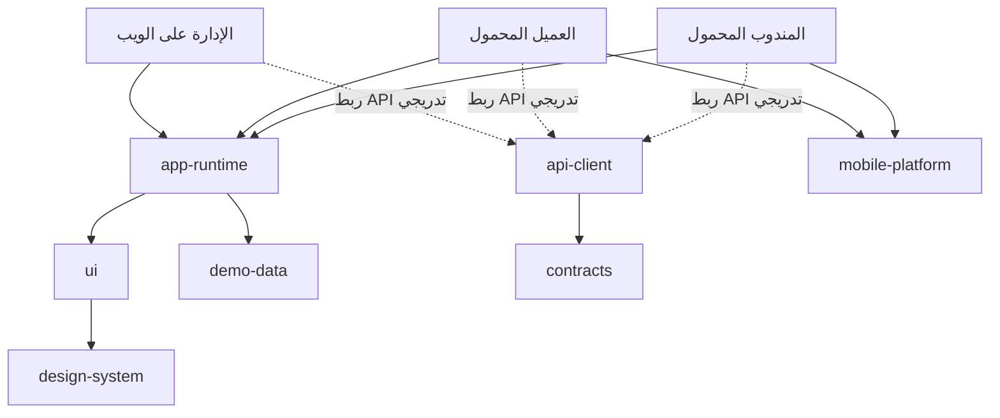
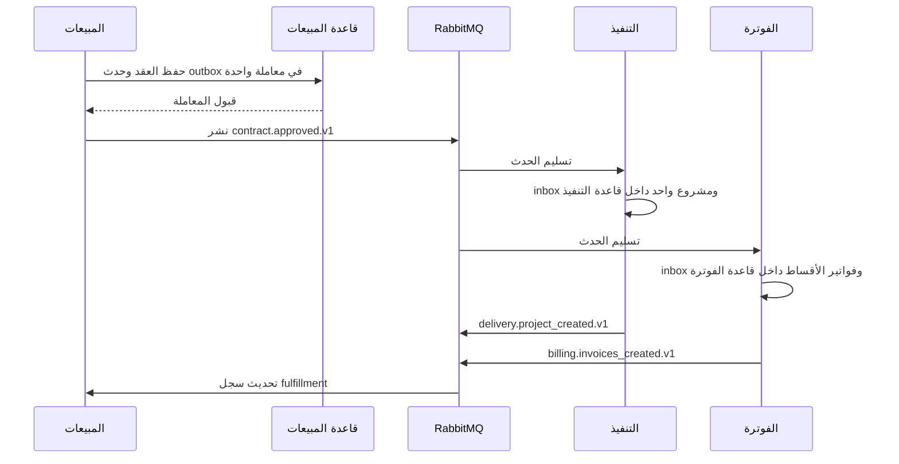

# Elvorance Enterprise 2.0 — البنية وحدود التنفيذ

## ما الذي تغيّر؟

تحتوي الحزمة ثلاثة عملاء مستقلين داخل npm workspaces: تطبيق المندوب المحمول، تطبيق العميل المحمول، ولوحة الإدارة على الويب. يعاد استخدام التصميم العربي RTL والخطوط والأيقونات والمكونات الأصلية. توجد خلفية مرجعية منفصلة تتكون من سبع خدمات أعمال و API Gateway؛ لكل خدمة بناء وحزمة تشغيل ومهاجرات وقاعدة بيانات وحساب اتصال خاص بها.

**الواجهات الحالية تعمل بمهايئ البيانات التجريبية المحلي.** لم يتحول كل زر من الأزرار الحالية إلى طلب API. خلفية الخدمات تنفذ رحلة مرجعية وعقودًا قابلة للاختبار، وتبقى أعمال ربط الواجهات والمصادقة الفعلية محددة في [مصفوفة الانتقال](MIGRATION-MATRIX.md). وجود مشروع Capacitor أصلي لا يعني نجاح بناء APK أو تشغيل iPhone؛ هذه أدلة مستقلة.

## تنظيم المستودع

| المسار                     | المسؤولية                                                  | ما لا يملكه                           |
| -------------------------- | ---------------------------------------------------------- | ------------------------------------- |
| `apps/rep-mobile`          | تسجيل تطبيق المندوب، شاشاته وتهيئة Capacitor               | تنفيذ خدمة المبيعات أو حالة تطبيق آخر |
| `apps/client-mobile`       | شاشات العميل وتهيئة Capacitor                              | تنفيذ الدفع أو قاعدة المشاريع         |
| `apps/admin-web`           | شاشات المدير وواجهة الويب                                  | تجاوز صلاحيات الخادم                  |
| `packages/design-system`   | CSS، NotoSansArabic، الأيقونات و tokens                    | قواعد الأعمال أو التخزين              |
| `packages/ui`              | المكونات والبدائيات المشتركة                               | استيراد التطبيقات                     |
| `packages/app-runtime`     | التوجيه والغلاف والتفاعل مع مهايئ العرض الحالي             | خدمة أعمال مستقلة أو مصادقة خادم      |
| `packages/demo-data`       | بيانات البداية ومستودع التجربة المحلية                     | بيانات تشغيل المؤسسة                  |
| `packages/api-client`      | نقل HTTP، token provider، الأخطاء و idempotency            | تخزين token أو تقرير الصلاحيات        |
| `packages/mobile-platform` | جسر Capacitor ودورة حياة الجهاز والأذونات                  | قواعد المبيعات أو عميل آخر            |
| `packages/contracts`       | أنواع wire والأحداث و OpenAPI                              | ORM أو تطبيق domain rules             |
| `packages/service-kit`     | HTTP، التحقق من الهوية، المعاملات والتخزين التقني          | استيراد domain من أي خدمة             |
| `packages/events`          | outbox/inbox وربط RabbitMQ وإعادة المحاولة                 | اتخاذ قرار أعمال نيابة عن خدمة        |
| `services/*`               | domain و application و transport و infrastructure لكل خدمة | شفرة أو قاعدة بيانات خدمة أخرى        |
| `infra`                    | صور التشغيل و Compose والتهيئة وفحوص التشغيل               | أسرار حقيقية أو بيانات مستخدمين       |

الرسم يوضح اتجاه الاعتماديات المشتركة، وليس ادعاء ربط جميع الشاشات بالخادم:

## الخدمات وملكية البيانات

ملاحظة توافق: لا تزال أسماء قواعد البيانات والأدوار المادية تبدأ بالبادئة `atlas_` في التهيئة الحالية. هذا معرّف تقني قديم، وليس اسم المنتج، ولا يجوز تغييره قبل تنفيذ خطة ترحيل للبيانات والأسرار والنسخ الاحتياطية.

المنفذ الوحيد المنشور افتراضيًا للخدمات هو 3000 على loopback. بقية المنافذ داخل شبكة Compose؛ منفذ إدارة RabbitMQ15672 منشور على loopback للتطوير. PostgreSQL غير منشور على المضيف.

| الخدمة           | المنفذ الداخلي | بادئة Gateway        | القاعدة والدور         | البيانات المملوكة                               |
| ---------------- | -------------: | -------------------- | ---------------------- | ----------------------------------------------- |
| `api-gateway`    |           3000 | `/v1/{service}/…`    | لا قاعدة               | التحقق من token، التوجيه و CORS                 |
| `identity`       |           3001 | `/v1/identity`       | `atlas_identity`       | `tenant_profiles`, `memberships`                |
| `crm`            |           3002 | `/v1/crm`            | `atlas_crm`            | `customers`, `regions`                          |
| `sales`          |           3003 | `/v1/sales`          | `atlas_sales`          | `visits`, `quotes`, `contracts`, `fulfillments` |
| `delivery`       |           3004 | `/v1/delivery`       | `atlas_delivery`       | `projects`، المراحل والتسليمات داخله            |
| `billing`        |           3005 | `/v1/billing`        | `atlas_billing`        | `contract_accounts`, `invoices`, `payments`     |
| `tracking`       |           3006 | `/v1/tracking`       | `atlas_tracking`       | `tracking_sessions` وآخر نقطة مسموحة            |
| `communications` |           3007 | `/v1/communications` | `atlas_communications` | `notifications`, `tickets` والردود              |

يملك كل نطاق أيضًا `schema_migrations` و `outbox` و `inbox` و `idempotency_keys` داخل قاعدته. تخزن الجداول aggregates بصيغة JSONB مع أعمدة الهوية والنسخة والمستأجر، وتطبق سياسة RLS ومرشح المستأجر. لا تُشارك جداول ORM بين الخدمات. إعداد Compose يجمع قواعد منطقية مستقلة داخل PostgreSQL 16 واحد لتسهيل التطوير؛ هذا ليس عزلًا ماديًا على سبعة خوادم. يمكن نقل قواعد الخدمات إلى مضيفين مختلفين بتغيير بيانات الاتصال الخاصة بكل خدمة.

المصدر التنفيذي لهذه الملكية هو `services/<name>/src/infrastructure/migrations/001_initial.ts`. أي إضافة جدول تبدأ في خدمة مالكة واحدة، وتصل معلوماته إلى المستهلك عبر عقد HTTP أو حدث.

## رحلة العقد والتسليم والفوترة

تقرأ المبيعات سياق العميل من CRM عبر HTTP مع هوية الطالب قبل قبول العملية الحساسة. لا تفتح اتصالًا إلى قاعدة CRM. اعتماد العقد يثبت snapshot البنود والشروط والأقساط، ويكتب حدث الاعتماد في outbox ضمن معاملة المبيعات نفسها.

قد يعيد `GET /v1/sales/contracts/{id}/fulfillment` حالة `pending` إلى أن تكتمل استجابة المستهلكين. لا توجد معاملة موزعة تغلق قواعد الخدمات دفعة واحدة. إعادة تسليم الحدث متوقعة؛ inbox وقيود uniqueness تمنع إنشاء مشروع أو فواتير مكررة. يحتفظ outbox بالحدث إذا انقطع broker، وتعرض readiness الخدمة حالة degraded حتى استعادة الاتصال. التفاصيل والسياسة التطورية في [ADR-003](adr/003-events-and-consistency.md).

## الهوية والثقة

في التطوير فقط يستخدم Compose `AUTH_MODE=dev-hs256` مع مفتاح محلي يولده helper ولا يطبعه. لا يمثل هذا تسجيل دخول المستخدم النهائي. في الإنتاج يطلب المرجع `AUTH_MODE=oidc` و issuer و audience و JWKS عبر HTTPS. ترفض النواة وضع HS256 التطويري عندما تكون `NODE_ENV=production`.

تأتي `sub` و `tenant_id` و `roles` و `rep_id` أو `client_id` من token مُتحقق منه. بيانات `session` القديمة في المتصفح أو headers يرسلها المستخدم لا تصبح صلاحيات موثوقة. خدمة الهوية تحتفظ بملفات المؤسسة والعضوية؛ لا تصدر tokens ولا تستبدل مزود OIDC. الربط النهائي يحتاج تسجيل دخول مناسبًا للويب و PKCE على الهاتف وتخزينًا آمنًا؛ مصفوفة الانتقال تسجله صراحة.

## عقود المكونات والخدمات

- التصميم يعتمد على الأصول المشتركة الأصلية وترتيب CSS. لا تحتوي شاشة تطبيق على نسخة خاصة معدلة من خطوط أو أزرار الحزمة المشتركة دون تغيير موثق لمرجع التصميم.
- التطبيق يسجل مساراته وإجراءاته؛ `app-runtime` يوفر الغلاف والتوجيه، ومهايئ البيانات يحدد مصدر القراءة والكتابة. لا يستورد التطبيق شاشات تطبيق آخر.
- عميل API يستقبل `baseUrl` و `accessToken()` ويعيد أخطاء ذات code/status. لا يقرر أن الإجراء مسموح؛ الخادم يعيد فحص الهوية والملكية والنسخة.
- عقد HTTP العام في `packages/contracts/openapi.json`. البوابة تحذف جزء اسم الخدمة عند التوجيه: `/v1/sales/quotes` يصبح `/v1/quotes` داخل المبيعات.
- كل أمر قابل للتكرار يحتاج مفتاح idempotency ثابتًا لنفس نية المستخدم. إعادة استخدام المفتاح لطلب مختلف ترفض؛ النسخة المتوقعة تمنع القرار المبني على سجل تغير بعد عرضه.
- أحداث `schemaVersion: 1` تحمل `id` و `source` و `tenantId` و `aggregateId` و `aggregateVersion` و `correlationId`. لا تُضمّن كائنات تشغيل أو imports إلى domain خدمة أخرى.

## التشغيل والتحقق

ابدأ بـ[Windows](LOCAL-DEVELOPMENT-WINDOWS.md) أو[Linux](LOCAL-DEVELOPMENT-LINUX.md). البناء المستقل يستخدم lockfile الجذر و `npm ci`. تبني صورة الخدمة حزمة ESM واحدة، وتنسخ إلى مرحلة التشغيل تلك الحزمة فقط، وتعمل بمستخدم `node` مع جذر ملفات للقراءة فقط في Compose.

مدقق الحدود يفحص manifests و AST الخاص بـ JS/TS؛ لا يفحص SQL وقت التشغيل. فحص عزل الاتصال بين القواعد متاح بصورة مستقلة، ولا توجد نتيجة Docker مزعومة في هذه البيئة. جدول [التحقق](VERIFICATION.md) يفصل الدليل المنفذ عن البوابات التي تحتاج Docker أو جهازًا أصليًا.
