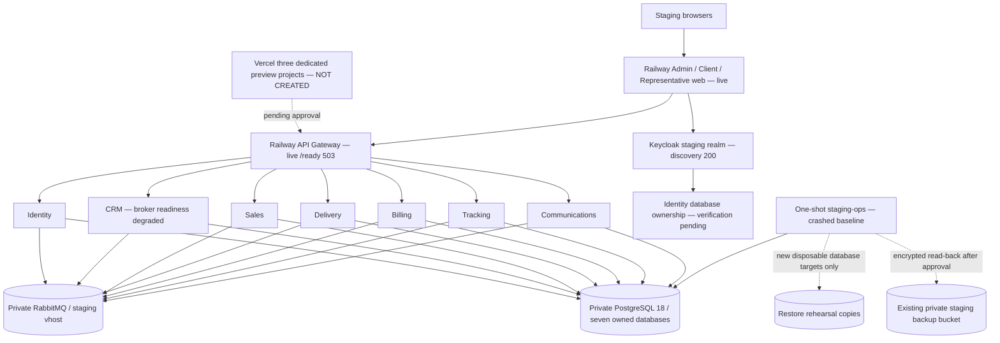

# Sprint 02 — isolated staging, approval pending

## Status and evidence boundary

This is a pre-approval implementation, **not a successful staging deployment**. No Railway or Vercel configuration was changed by this task. PR #12 is a draft stacked on PR #11, not merged into main. The deployed branch remains `feat/hosted-staging-20261123`.

The real baseline was inspected on 23 November 2026. Railway has 15 service resources: 14 latest deployments report SUCCESS, but staging-ops is CRASHED. At **10:03:38 UTC**, gateway `/health` returned 200 and `/ready` returned **503**, with CRM false and the other six dependencies true. Keycloak discovery and all three Railway frontend readiness/build endpoints returned 200 over verified HTTPS. Frontend metadata identifies `cc53eb633d86be5a17abc1ca955c8705477b9f74`; this is static readiness, not an end-to-end frontend proof.

Evidence: [HTTP observations](baseline-http.json), [redacted platform inventory](platform-baseline.json), and GitHub read-only run [45152557059](https://github.com/baraabd/Elvorance-Enterprise/actions/runs/45152557059). Its SUCCESS means the observation/export job ran; it does **not** mean the observed endpoints were all healthy. Diagnostic artifact SHA256: `87abcab2d709c8e27dfee23ddc79af80cf6d2661320f70ec26eda39b2034cbf7`. Source/dependency lock SHA256: `e25889783eac39981f008e6e3eaa410ab5c527d416a6067d4a1ee5e043347da0`.

The connected Vercel team has five projects and **no Elvorance project**. Proposed Vercel URLs are not provisioned or evidence. Project IDs/origins intentionally remain null; the builder refuses to deploy to an unregistered project.

## Implemented safeguards

- Startup checks in gateway and all seven services bind exact Railway project/environment IDs, source SHA, OIDC realm/audience/JWKS, private upstreams, owned database/role and broker vhost. Misconfiguration fails before connection; local disposable tests remain supported. This is future enforcement, not proof that current opaque variables match.
- A reproducible topology gap: `crm.configuration_published.v1` was emitted with mandatory publisher confirms but had no durable subscriber. An explicit audit-only quorum queue now covers six informational event types. No wildcard sink masks unknown events. Retention is seven days, capacity 10,000, overflow rejects publication. Existing business subscriber bindings are unchanged. This is a likely cause of the observed CRM retry loop; confirmation in hosted staging still requires approved deployment and actual broker/outbox observations.
- Event failures carry allowlisted phase/error codes. Readiness becomes true only after the first successful outbox cycle, and closes/cancellation mark it false. Logs omit raw driver errors and request query strings.
- Transactional, advisory-locked migration ledger records SQL checksums and source revision, rejects changed/apparently downgraded history, and refuses legacy checksum backfill without the exact reviewed manifest plus prior source SHA. Baseline is an operator attestation, **not reconstruction or proof of historical SQL**.
- AES-256-GCM backups use unique object context and exact staging bucket binding. Restore rehearsal can upload encrypted dumps, download them, validate both ciphertext and plaintext digests, authenticate, then restore the **downloaded** data into new random databases using the existing row/RLS/isolation checks. No existing database is a restore destination. The signer matches an independent botocore reference vector.
- Preview-only Vercel Build Output API packaging supports exact callback origin, CSP/security headers, callback routing, asset digests and source metadata. Missing project ownership/registration blocks the build.
- New quality/security CI uses pinned actions, PostgreSQL 18, clean lockfile install, format/types/boundaries/build/tests, source-bound tooling and high/critical dependency audit. Existing real broker/OIDC/native lanes remain required for release. The release approval workflow is deliberately **gate-only**; it has no provider tokens or cloud mutators.

## Infrastructure map

All inspected Railway services use the existing Singapore region. No region move, public database/broker proxy, production DNS change, existing volume replacement or database major upgrade is proposed. Public TLS was verified by the actual HTTPS probes; internal application-level TLS is **not** thereby proven. Current code explicitly allows only the existing private PostgreSQL/AMQP topology; do not call that end-to-end TLS.

## IaC, CI/CD and release prerequisites

Existing `infra/railway/gateway.json` and `domain-service.json` are legacy service-level configurations; dashboard values can drift and the observed deployment retry setting differs. `deployment-plan.json` is a reviewed operational plan, **not a fabricated provider schema or an applied IaC export**. Import actual project-level Railway IaC with config pull, redact secret values, review drift and ownership, then obtain approval for the resulting plan. Do not apply a partial manifest that deletes unmanaged volumes/buckets or silently enables a second config owner. Pin existing image digests only after provider inspection; this PR does not invent digests or upgrade PostgreSQL/RabbitMQ.

Main was unprotected at inspection. Main's S01 FULL-CI implementation also differs from the hosted PR ancestry. Before integration preserve S01 gates, reconcile the stacked branches, obtain independent review, and configure actual branch and staging-environment protection. YAML alone is not protection. The gate checks current main protection, at least one independent environment reviewer, protected branches, and all named successful workflows at the exact approved SHA. Cloud apply remains a separately approved connector operation.

The opt-in monitor workflow is disabled unless `STAGING_MONITOR_ENABLED=true`; after merge its scheduled probes fail on unhealthy responses and retain metadata only. Railway monitor inspection failed because Automations was unavailable. Neither alert routing nor an on-call response has been tested.

## Execution and acceptance after approval

See [deployment plan](../../infra/railway/staging/deployment-plan.json), [rollout and rollback](runbook.md) and [blockers](blockers.md). Code review, successful disposable tests and successful container status are not interchangeable with staging acceptance. Record exact deployed service SHAs, URLs, three stable gateway-ready samples, PKCE/RBAC/CORS denial tests, tenant/database isolation, broker confirms/outbox drain, seven encrypted-object restores, cleanup results and alert delivery. Keycloak recovery and off-region/PITR proof are separate outstanding requirements.
